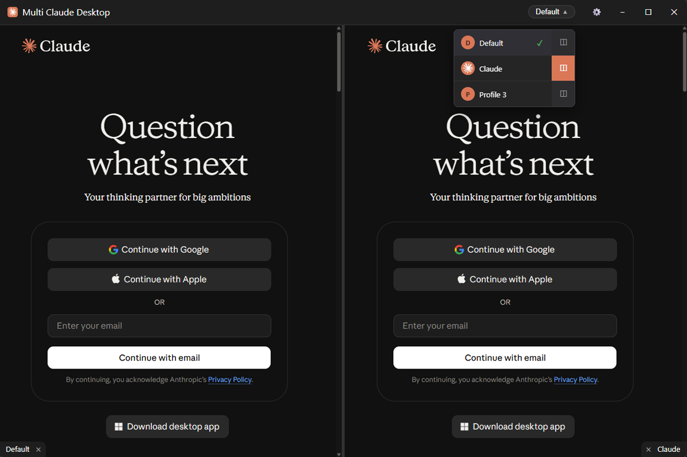
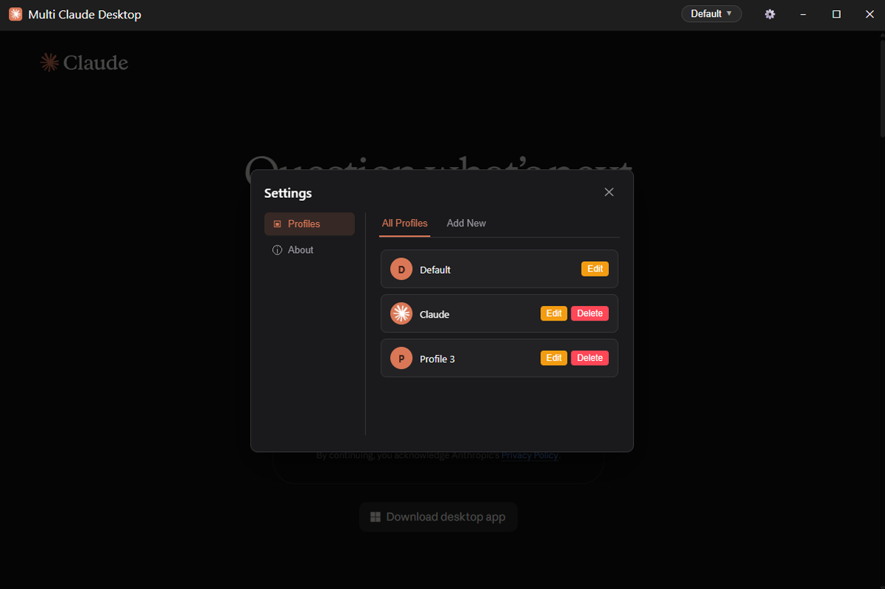

# Multi-Claude

A clean, native-feeling desktop wrapper for [Claude.ai](https://claude.ai) that lets you run multiple isolated profiles at once.

---

> [!NOTE]
> Multi-Claude is an unofficial, open-source project. It is not affiliated with, endorsed by, or associated with Anthropic. It is simply a community-built web wrapper designed to make account management easier.

## Why Multi-Claude?

While the official Claude app is great, it doesn't support multiple profiles. If you juggle different accounts (like one for work and one for personal projects), you usually have to constantly log in and out or use entirely different browsers.

**Multi-Claude** wraps the web app in a custom interface — keeping your workspaces separate without the browser clutter.

- **Zero login headaches** — switch between your work and personal accounts in two clicks
- **Fully sandboxed** — uses isolated session partitions so your cookies and data never mix
- **Native feel** — custom title bar and borderless window design

## Features

### Core

- **Isolated Sessions:** Every profile operates independently. Logging out of one doesn't affect the others.
- **Split View:** Run two profiles side by side in one window, so you can pull from one chat and paste into another without switching. See [Using Split View](#using-split-view).
- **Quick Switcher:** A custom title bar dropdown lets you instantly bounce between profiles.
- **Auto-Resume:** The app remembers your last active workspace (and your split view, if you had one open) and loads it automatically on boot.
- **Profile Management:** Easily create, edit, or wipe all data for specific profiles from the settings menu.

## Using Split View

1. Click the profile name in the title bar to open the profile dropdown.
2. Each profile has a split button (◫) at the end of its row. Click it to open that profile in a second view on the right. The button lights up for the profile that's currently split.
3. Click a different profile's split button to swap the second view, or click the lit-up one again to close the split.
4. Drag the divider between the two views to resize them.
5. While split, each view shows a small tab in its bottom corner with the profile name and a close (✕) button. Closing the left view promotes the right view to be your main view without reloading it.

Clicking a profile's row (not its split button) still changes the **main** view, which is marked with a checkmark and a soft highlight. Both views are independent sessions, and copy/paste between them works as it normally does on your system clipboard.

## Screenshots

|           Profile Switcher           |            Settings Menu             |
| :----------------------------------: | :----------------------------------: |
|  |  |

## Getting Started

### Download

Grab the latest release for your platform from [**Releases**](https://github.com/Maxumi-IX/multi-claude/releases):

| Platform | File              |
| -------- | ----------------- |
| Windows  | `.exe` installer  |
| Debian   | `.deb` package    |
| Arch     | `.pacman` package |
| AppImage | `.AppImage`       |

### First Launch

1. Open the app (it will load a "Default" profile).
2. Log into your primary Claude account.
3. Click the gear icon `⚙️` in the title bar to open **Settings**.
4. Create a new profile (e.g., "Work").
5. Click the profile name in the title bar to switch to it, and log into your secondary account!
6. Want both at once? Open the profile dropdown and click the split button (◫) next to the other profile.

## Tech Stack

| Layer     | Technology                                                                    |
| --------- | ----------------------------------------------------------------------------- |
| Backend   | [Electron](https://www.electronjs.org/) (Node.js, TypeScript)                 |
| Frontend  | HTML, CSS, TypeScript                                                         |
| Packaging | [electron-builder](https://www.electron.build/) (NSIS, deb, pacman, AppImage) |

## License

[MIT](LICENSE) &copy; [Maxumi-IX](https://github.com/Maxumi-IX)
